<div align="center">


# Articulo

### Automate your work across every app

Visual, no-code workflows that connect **Google Drive, Slack, Notion and Discord**.<br/>
Set it up once and let it run.

[](https://nextjs.org)
[](https://react.dev)
[](https://www.typescriptlang.org)
[](https://www.prisma.io)
[](https://clerk.com)
[](https://stripe.com)
[](https://tailwindcss.com)

[Quick start](#-quick-start) · [Features](#-features) · [Screenshots](#-screenshots) · [Pricing](#-pricing) · [Setup guide](./articulo/SETUP.md)

<br/>

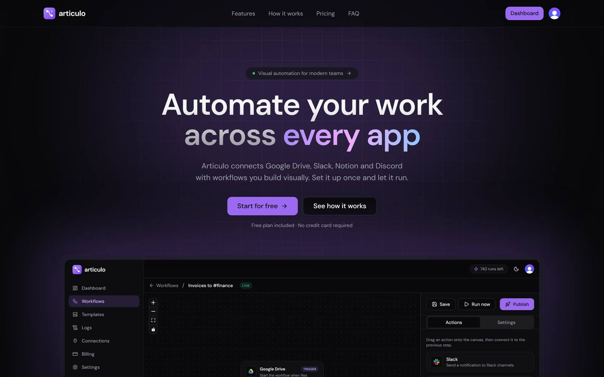

</div>

---

## ✨ Features

| | |
| --- | --- |
| 🧩 **Visual workflow builder** | Drag triggers and actions onto an infinite canvas and connect them. No code, no YAML. |
| ⚡ **Real-time triggers** | Workflows start the moment files change in Google Drive. Or press **Run now** to start one by hand. |
| 🔌 **Native integrations** | Slack, Notion, Discord and Google Drive over secure OAuth. Tokens never leave the server. |
| 📜 **Step-by-step logs** | Every run is recorded with the result of each step, so failures are easy to find and fix. |
| 📊 **Usage dashboard** | Runs, success rate and remaining credits at a glance, plus a getting-started checklist for new users. |
| 💳 **Subscriptions built in** | Stripe Checkout, customer portal and usage-based run credits per plan. |
| 🌗 **Dark and light themes** | Fully responsive, with mobile navigation, loading skeletons and accessible components. |
| 🛡️ **Multi-tenant by design** | Every query is scoped to the signed-in user, webhooks are signature-verified, and the app ships with security headers. |

## 📸 Screenshots

<table>
  <tr>
    <td width="50%">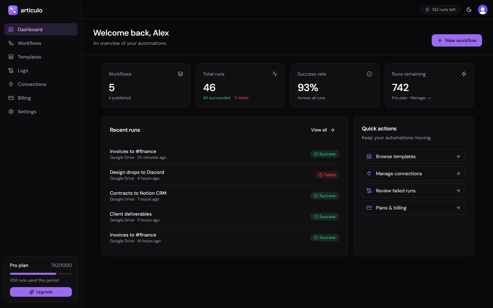<p align="center"><b>Dashboard</b>: runs, success rate and credits</p></td>
    <td width="50%">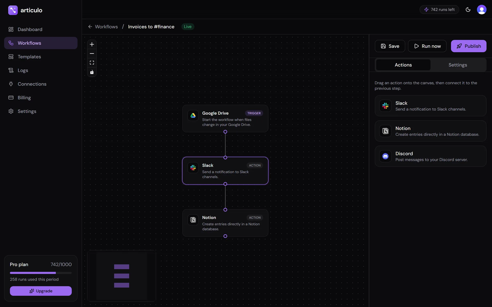<p align="center"><b>Workflow editor</b>: drag, connect, publish</p></td>
  </tr>
  <tr>
    <td>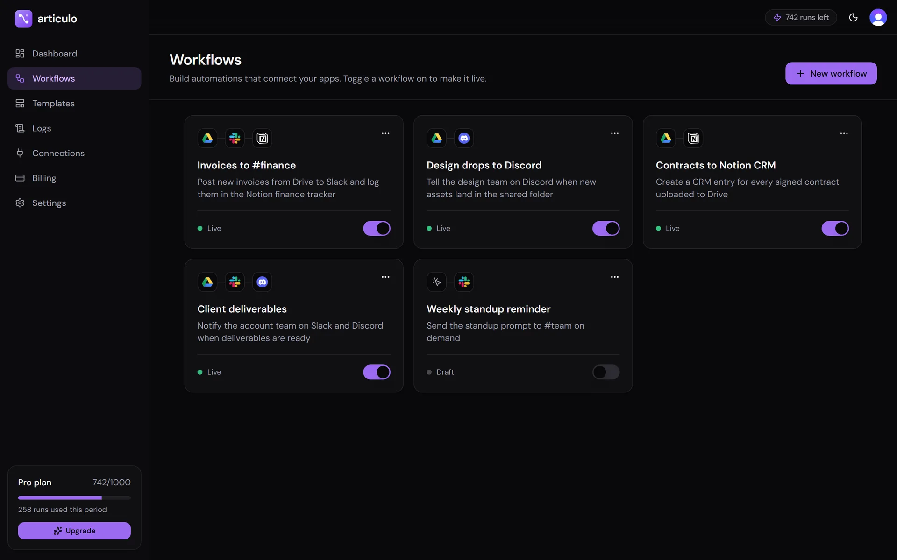<p align="center"><b>Workflows</b>: toggle automations live</p></td>
    <td>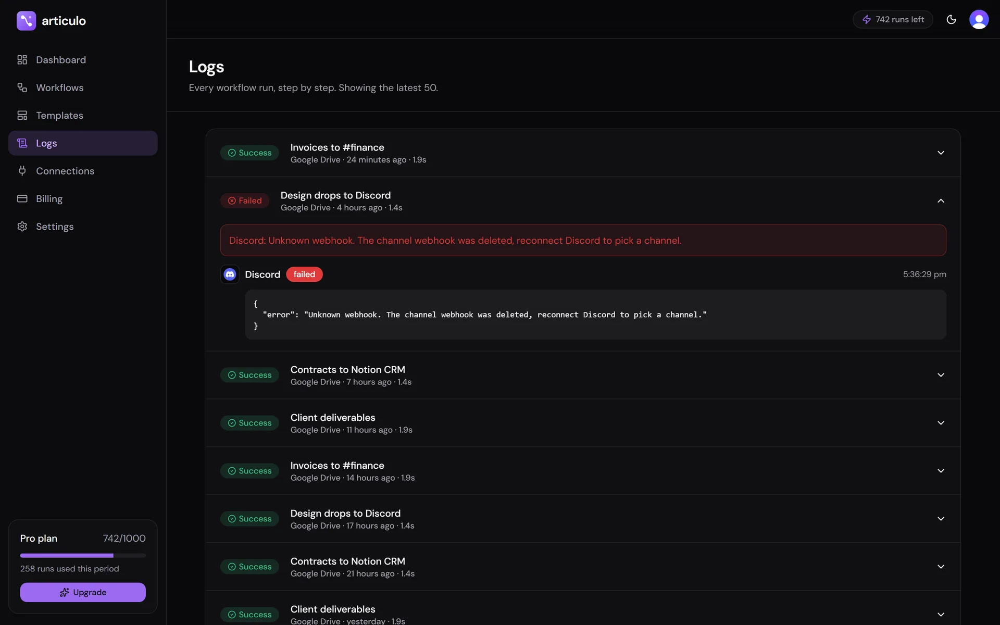<p align="center"><b>Logs</b>: every step of every run</p></td>
  </tr>
  <tr>
    <td>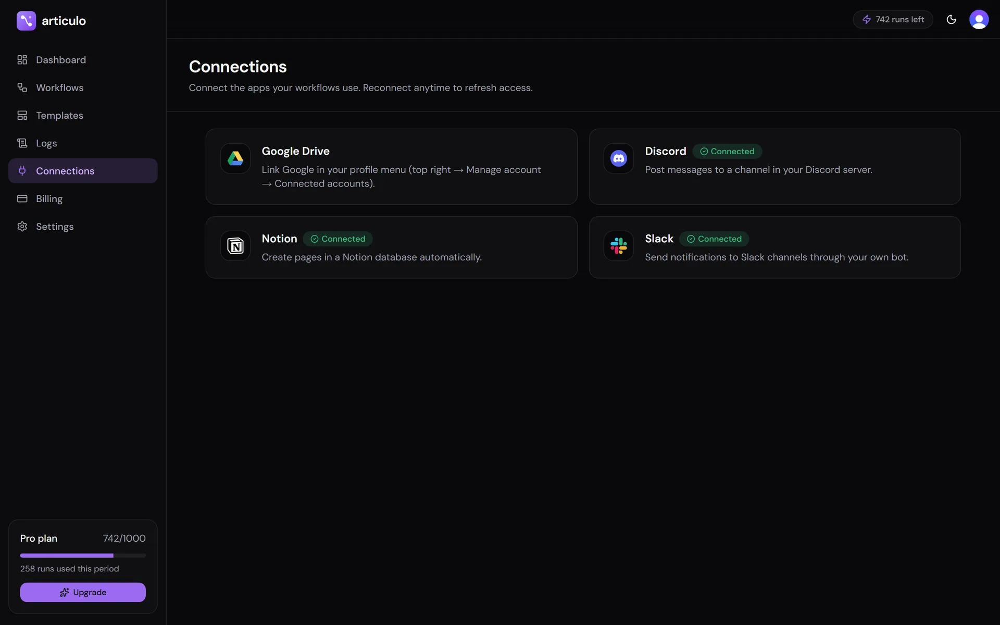<p align="center"><b>Connections</b>: one-click OAuth</p></td>
    <td>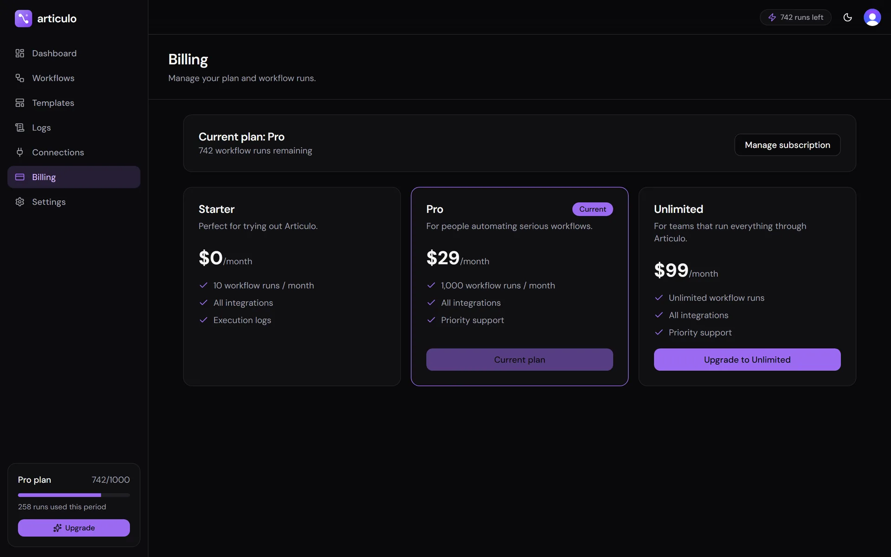<p align="center"><b>Billing</b>: Stripe subscriptions</p></td>
  </tr>
  <tr>
    <td>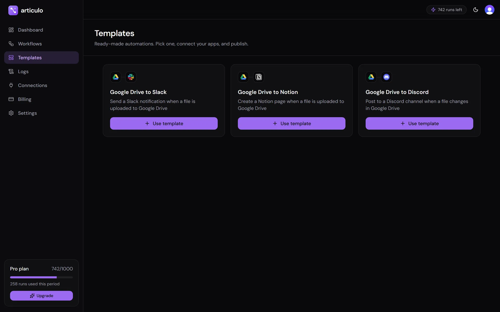<p align="center"><b>Templates</b>: start from a proven flow</p></td>
    <td>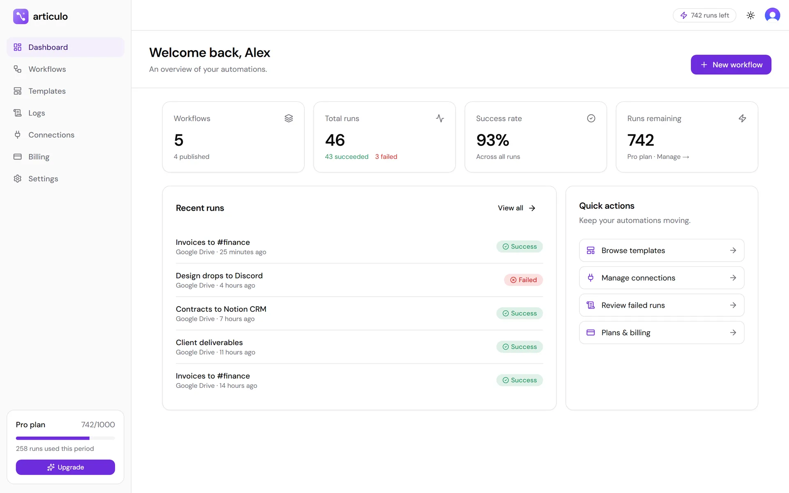<p align="center"><b>Light theme</b></p></td>
  </tr>
</table>

<p align="center">
  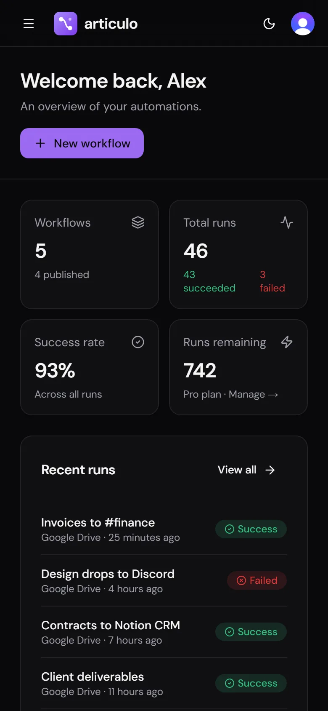
  &nbsp;&nbsp;
  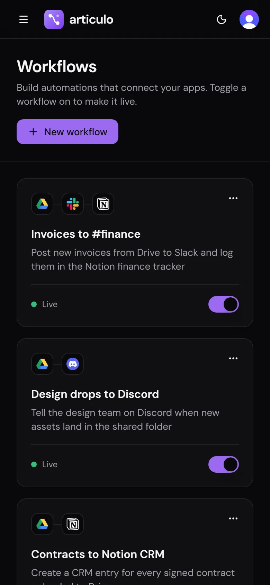
</p>

## 💰 Pricing

Plans are configured in [`src/lib/plans.ts`](./articulo/src/lib/plans.ts) and billed through Stripe.

| | **Starter** | **Pro** | **Unlimited** |
| --- | :---: | :---: | :---: |
| Price | $0 / month | $29 / month | $99 / month |
| Workflow runs | 10 / month | 1,000 / month | Unlimited |
| All integrations | ✓ | ✓ | ✓ |
| Execution logs | ✓ | ✓ | ✓ |
| Priority support | | ✓ | ✓ |

## 🚀 Quick start

You don't need a `.env` file to try Articulo locally. Login runs in Clerk's keyless dev mode, and the database runs locally.

```bash
cd articulo
npm install
npm run setup   # starts a local Postgres and applies migrations
npm run dev     # → http://localhost:3000
```

Requires **Node.js 20.9+**. Run `npm run check-env` to see which integrations are enabled.
The [setup guide](./articulo/SETUP.md) covers each API key, Stripe billing, deployment to Vercel and a launch checklist.

## 🏗️ How it works

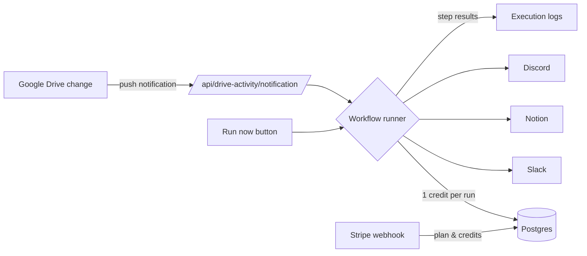

## 🛠️ Tech stack

| Layer | Technology |
| --- | --- |
| Framework | Next.js 16 (App Router, Turbopack), React 19 with the React Compiler |
| Language | TypeScript |
| Auth | Clerk |
| Database | PostgreSQL (Neon, Supabase or local) with Prisma 7 |
| Payments | Stripe Checkout and Customer Portal |
| UI | Tailwind CSS, shadcn/ui, Radix, lucide icons |
| Editor | React Flow, Zustand |
| Integrations | Google Drive API, Slack Web API, Notion API, Discord webhooks |

## 🗺️ Roadmap

- [ ] More actions: email, AI summaries, custom webhooks, Google Calendar
- [ ] Conditional branches and scheduled (cron) triggers
- [ ] Team workspaces and shared workflows
- [ ] Usage analytics charts and run-history export

---

<div align="center">
  <br/>
  <sub><b>Articulo</b>: the connecting point between your apps.</sub>
</div>
